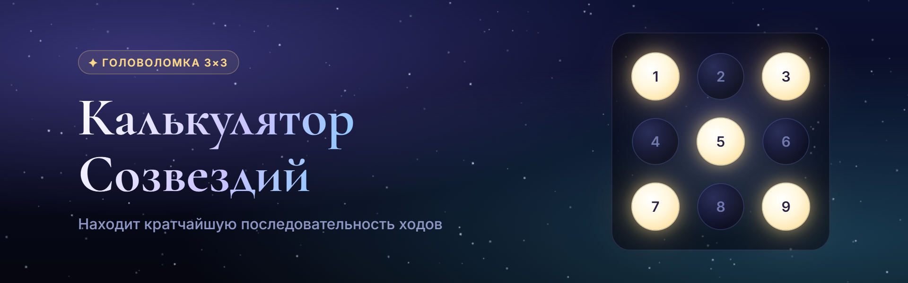
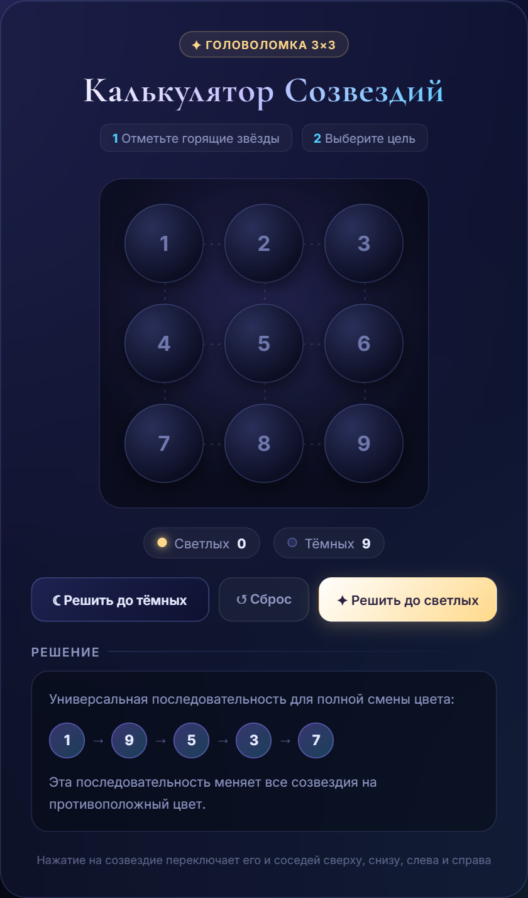
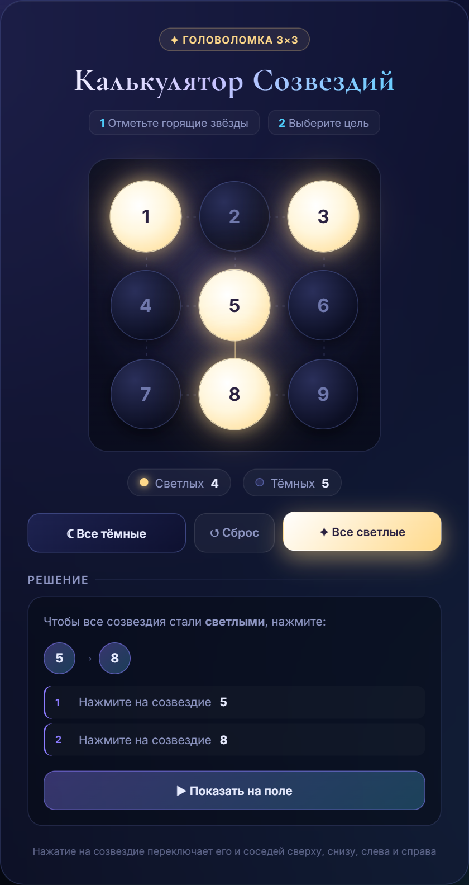
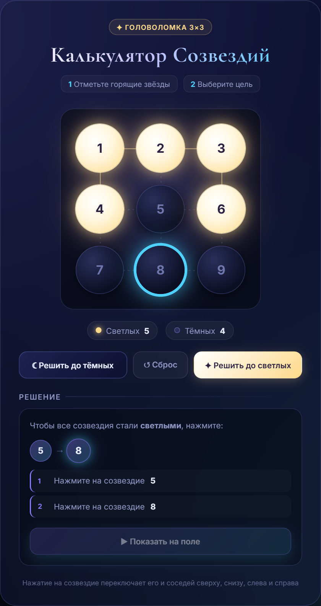
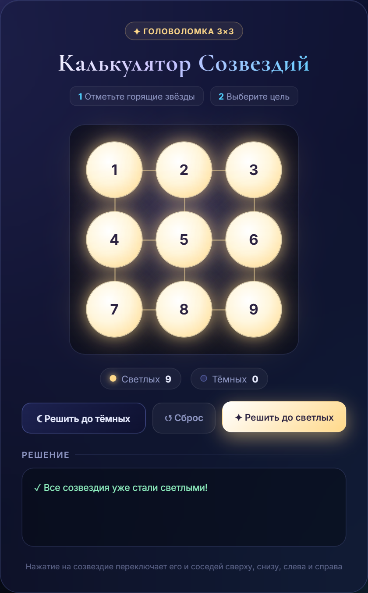

<div align="center">



# ✦ Калькулятор Созвездий 3×3

**Веб-калькулятор, который находит кратчайшую последовательность ходов для головоломки «Созвездия»**

[](#-технологии)
[](#-технологии)
[](#-технологии)
[](#-технологии)

[](https://github.com/THEChrismoth/Constellation-Calculator/commits/main)
[](https://github.com/THEChrismoth/Constellation-Calculator)
[](https://github.com/THEChrismoth/Constellation-Calculator/stargazers)

[Возможности](#-возможности) •
[Скриншоты](#-скриншоты) •
[Быстрый старт](#-быстрый-старт) •
[Использование](#-использование) •
[Алгоритм](#-как-это-работает)

</div>

---

## 📖 Содержание

- [О проекте](#-о-проекте)
- [Возможности](#-возможности)
- [Скриншоты](#-скриншоты)
- [Быстрый старт](#-быстрый-старт)
- [Использование](#-использование)
- [Правила головоломки](#-правила-головоломки)
- [Как это работает](#-как-это-работает)
- [Структура проекта](#-структура-проекта)
- [Технологии](#-технологии)
- [Участие в разработке](#-участие-в-разработке)
- [Автор](#-автор)

---

## 🌌 О проекте

**Калькулятор Созвездий** — одностраничное веб-приложение для решения головоломки на поле 3×3, где нажатие на созвездие переключает его и соседние созвездия. Достаточно перенести текущее состояние поля из игры, выбрать цель — все тёмные или все светлые — и калькулятор покажет, на какие созвездия нажать.

Приложение — это один файл `index.html`: без сборки, без сервера, без зависимостей.

## ✨ Возможности

| | Возможность | Описание |
|:-:|---|---|
| 🎯 | **Кратчайшее решение** | Находит решение с минимальным количеством нажатий |
| 🔁 | **Две цели** | Сделать все созвездия тёмными или все светлыми |
| ▶️ | **Анимация решения** | Кнопка «Показать на поле» по шагам проигрывает решение на доске |
| 🔦 | **Подсветка шагов** | При наведении на шаг решения нужное созвездие подсвечивается на поле |
| 🔄 | **Универсальная комбинация** | `1 → 9 → 5 → 3 → 7` инвертирует цвет всех созвездий |
| 🌠 | **Космический интерфейс** | Анимированное звёздное небо, светящиеся звёзды и линии созвездия |
| 📱 | **Адаптивность** | Удобно на компьютере, планшете и телефоне |
| ♿ | **Доступность** | Управление с клавиатуры и поддержка `prefers-reduced-motion` |

## 📸 Скриншоты

<div align="center">

| Главный экран | Найденное решение |
|:-:|:-:|
|  |  |

| Анимация решения | Цель достигнута |
|:-:|:-:|
|  |  |

**Мобильная версия**


</div>

## 🚀 Быстрый старт

### Вариант 1 — просто открыть файл

```bash
git clone https://github.com/THEChrismoth/Constellation-Calculator.git
cd Constellation-Calculator
```

Затем откройте `index.html` в любом современном браузере.

### Вариант 2 — локальный сервер

```bash
# Python 3
python -m http.server 8000

# или Node.js
npx serve .
```

И перейдите по адресу [http://localhost:8000](http://localhost:8000).

> [!TIP]
> Проект можно опубликовать через **GitHub Pages**: *Settings → Pages → Deploy from a branch → `main` / root*.

## 🕹 Использование

1. **Перенесите состояние поля из игры.** Нажимайте на созвездия, чтобы переключать их между тёмным ☾ и светлым ✦. В калькуляторе клик меняет только одно созвездие, так что поле удобно заполнять.
2. **Выберите цель:**
   - **☾ Решить до тёмных** — решение, после которого все созвездия станут тёмными;
   - **✦ Решить до светлых** — решение, после которого все созвездия станут светлыми.
3. **Повторите нажатия в игре** в указанном порядке. Чтобы сначала посмотреть результат, нажмите **▶ Показать на поле**.
4. **↺ Сброс** возвращает поле в состояние «все тёмные».

Пример вывода:

```text
Чтобы все созвездия стали светлыми, нажмите:

5 → 8

1  Нажмите на созвездие 5
2  Нажмите на созвездие 8
```

## 📜 Правила головоломки

Созвездия пронумерованы так:

```text
┌───┬───┬───┐
│ 1 │ 2 │ 3 │
├───┼───┼───┤
│ 4 │ 5 │ 6 │
├───┼───┼───┤
│ 7 │ 8 │ 9 │
└───┴───┴───┘
```

При нажатии на созвездие цвет меняют **оно само** и **соседи по стороне**: сверху, снизу, слева и справа. Например, нажатие на `5` переключает `2`, `4`, `5`, `6`, `8`, а нажатие на `1` — только `1`, `2`, `4`.

## 🧠 Как это работает

- **Порядок нажатий не важен:** каждое нажатие инвертирует фиксированный набор клеток, а инверсии коммутативны.
- **Двойное нажатие ничего не меняет:** оно возвращает клетки в исходное состояние, поэтому каждое созвездие имеет смысл нажать не более одного раза.
- Значит, достаточно перебрать **подмножества** из 9 созвездий, а их всего 2⁹ = **512**.
- Подмножества перебираются **по возрастанию размера** (сначала 1 нажатие, потом 2 и т. д.), поэтому первое найденное решение — кратчайшее.

Для поля 3×3 у любой начальной расстановки есть ровно одно такое решение, так что калькулятор всегда находит ответ, и мгновенно.

## 📁 Структура проекта

```text
Constellation-Calculator/
├── index.html            # Приложение целиком: разметка, стили и логика
├── README.MD             # Документация
└── docs/
    └── screenshots/      # Баннер и скриншоты для README
```

## 🛠 Технологии

- **HTML5** — семантическая разметка, кнопки с `aria-label`
- **CSS3** — custom properties, glassmorphism (`backdrop-filter`), grid, анимации
- **JavaScript (ES2017+)** — без фреймворков и библиотек
- **Canvas API** — анимированное звёздное небо
- **SVG** — линии созвездия между соседними клетками
- **Google Fonts** — Inter и Cormorant Garamond

Поддерживаются все современные браузеры: Chrome, Edge, Firefox, Safari.

## 🤝 Участие в разработке

Предложения и исправления приветствуются:

1. Сделайте форк репозитория
2. Создайте ветку: `git checkout -b feature/my-feature`
3. Закоммитьте изменения: `git commit -m "ADD: my feature"`
4. Отправьте ветку: `git push origin feature/my-feature`
5. Откройте Pull Request

Нашли ошибку? Создайте [issue](https://github.com/THEChrismoth/Constellation-Calculator/issues).

## 👤 Автор

**THEChrismoth** — [@THEChrismoth](https://github.com/THEChrismoth)

---

<div align="center">

Если калькулятор пригодился, поставьте ⭐ репозиторию!

</div>
